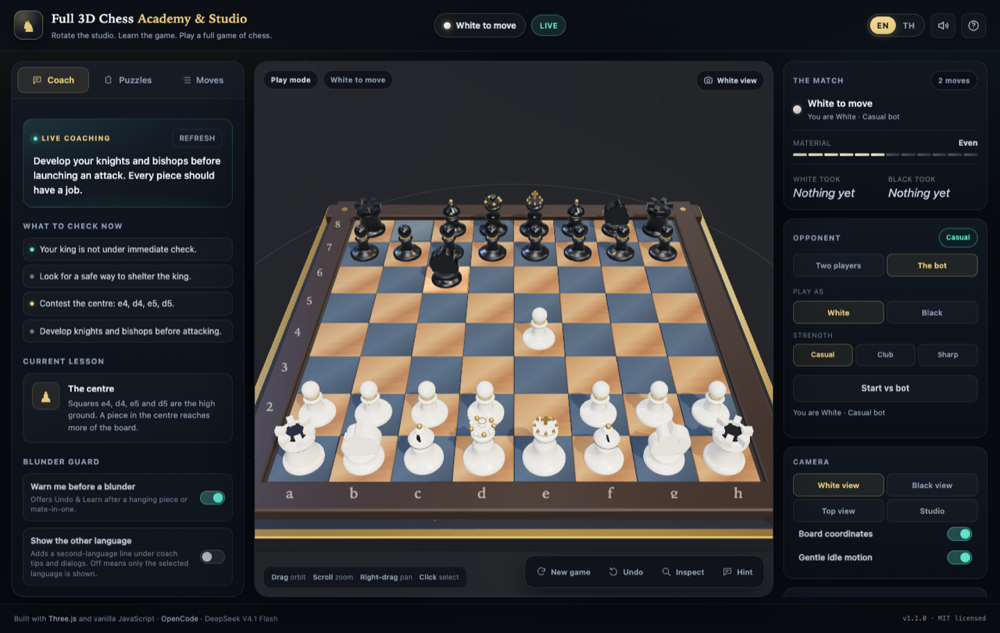
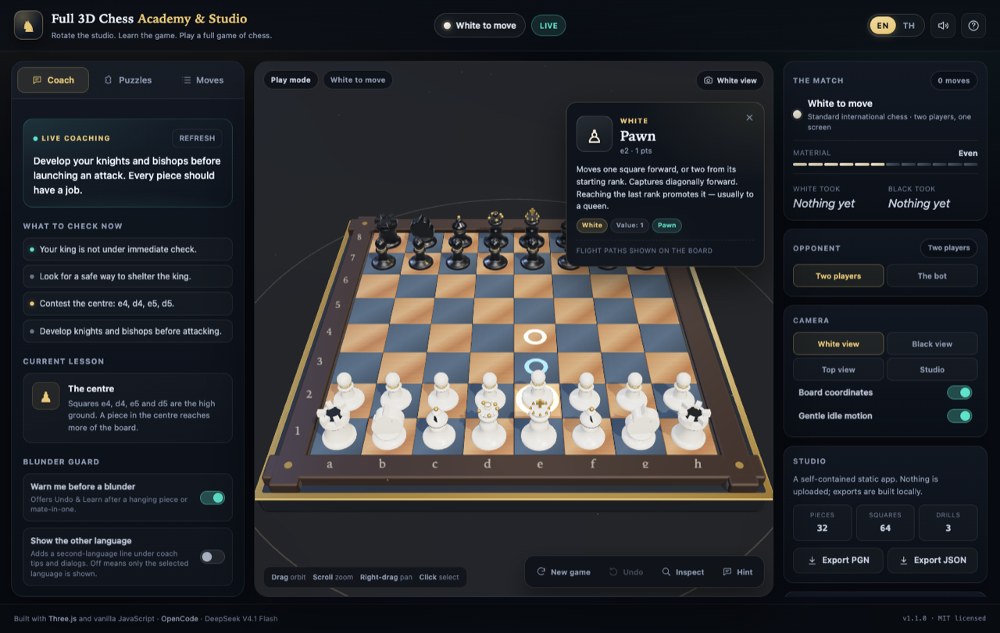
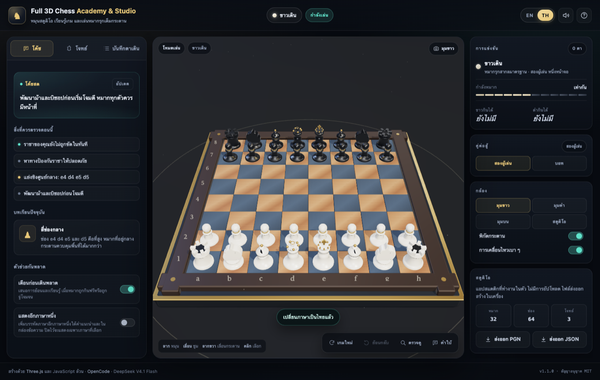

# Full 3D Chess Academy &amp; Studio

[](https://github.com/somphol/full-3d-chess-academy/actions/workflows/ci.yml)
[](https://somphol.github.io/full-3d-chess-academy/)
[](LICENSE)

A complete, interactive 3D chess studio in the browser. Play a full game against the built-in bot or a friend, inspect every piece in three dimensions, and learn with a bilingual coach, a blunder guard, and three tactical drills.

No framework, no backend, no build step, no tracking. One HTML page, one stylesheet, one ES module, Three.js from a pinned CDN.



## What you can do

### Play a full game
- Standard chess: pawn double-step, en passant, both castles, check, checkmate, stalemate, fifty-move, threefold repetition and insufficient material.
- Promotion asks which piece you want — with a one-line reason to consider a knight.
- Click a piece, then a glowing ring. Drag to orbit, scroll to zoom, right-drag to pan.
- Legal targets are teal, captures are red, castling is gold, the last move is amber, and a checked king glows red.
- Undo any move. Export the game as PGN or a full JSON progress file at any time.

### Play the bot

Switch the Opponent card to **The bot**, choose White or Black, and pick a strength:

| Level | Search | Feel |
| --- | --- | --- |
| **Casual** | 1 ply + captures, 42% random | Makes beginner-style choices and occasional slips |
| **Club** | 3 ply + quiescence | Punishes free material and simple mates |
| **Sharp** | 4 ply + quiescence, 1.4 s cap | Looks a few moves ahead and defends carefully |

The bot runs entirely in the page. It shows a *thinking* badge, then moves with the same animation, sound and move-list entry as a human. Undo takes back both the bot's reply and your move, returning the turn to you. If you play Black, the bot opens as White. A move that hangs material still triggers the blunder guard; the bot waits until you choose **Keep** or **Undo & learn**.

### Learn in three dimensions
- **Inspect any piece.** It lifts, sways, and a card shows its value, square and movement rules. Its paths are projected across the board as arcs and landing markers.
- **Live coach.** Bilingual tips react to checks, hanging pieces, development, the centre and the endgame, with a short “what to check now” list.
- **Undo &amp; learn.** After a move that hangs a piece or allows mate-in-one, the guard explains the threat in both languages and offers a clean undo.
- **Three drills.** Back-rank mate, queen-and-king mate, and a knight fork. Progress, streak and best run are saved.



### Bilingual by design — one language at a time

Every control, lesson, tip, drill and modal switches instantly between English and ไทย. **English mode shows no Thai, and Thai mode shows no English**: the selected language is the only one rendered in the interface, coach, dialogs and drill explanations. A separate **Show the other language** switch is off by default and, when enabled, adds a second-language line under coach tips and dialog copy for comparison. Chess notation stays in algebraic form in both languages.



### Sound and memory
- Lifts, drops, captures, castles, checks, promotions and puzzle fanfares are synthesised with the Web Audio API — no audio files.
- The current game, language, sound preference, board coordinates and puzzle streak are saved in `localStorage` and restored on reload.
- Exports are generated locally as Blobs. Nothing is uploaded.

## Quick start

```bash
cd full-3d-chess-academy
python3 -m http.server 8080
# open http://localhost:8080
```

There is nothing to install and nothing to build. Three.js 0.169.0 loads from jsDelivr, so the first load needs a network connection. Serve over HTTP rather than opening `index.html` directly: browsers block ES modules on `file://`.

The same folder deploys unchanged to GitHub Pages, Netlify, Cloudflare Pages or any static host.

## Controls

| Action | Mouse / touch | Key |
| --- | --- | --- |
| Orbit | Drag | — |
| Zoom | Scroll / pinch | — |
| Pan | Right-drag | — |
| Select / move | Click a piece, then a ring | — |
| Undo | Dock button | `U` |
| New game | Dock button | `N` |
| Inspect lens | Dock button | `I` |
| Switch language | EN / TH | `L` |
| Camera presets | White / Black / Top / Studio | `1` `2` `3` |
| Opponent / side / strength | Opponent card | — |
| Deselect / close | — | `Esc` |
| Help | Header `?` | `?` |

## The three drills

| # | Drill | Task | Idea |
| --- | --- | --- | --- |
| 01 | Back-rank mate | Mate in one | A rook owns the empty eighth rank while the king's own pawns block the exits. |
| 02 | The queen's kiss | Mate in one | A queen next to the king, protected by her own king, covers every escape. |
| 03 | Knight fork | Win the rook | A knight checks the king and attacks the rook at the same time. |

Drills live as JSON in `index.html` and are validated by the test suite (legal FEN, legal solution, SAN match, mate where promised). See [docs/PUZZLES.md](docs/PUZZLES.md).

## Project layout

```text
index.html            markup, dialogs, import map, drill data
style.css             studio shell, panels, responsive layout, modal system
script.js             chess engine + Three.js studio + interface controller
scripts/check.mjs     dependency-free verification suite
docs/                 architecture, testing, deployment, design, puzzles, privacy
assets/               screenshots used by this README and social cards
state.json            build provenance: time, tokens, model, deployment
```

Architecture, coordinate system and extension points: [docs/ARCHITECTURE.md](docs/ARCHITECTURE.md).

## Verification

```bash
node --check script.js
node scripts/check.mjs
```

The suite checks perft to depth 3, Kiwipete to depth 2, every special rule, SAN, draws, all drill positions, the bot's mate/capture/legality and state safety, bilingual key symmetry, English-only defaults, referenced element ids, CDN pinning, release documents and the state file. Two headless-Chrome passes exercised 97 interaction points: 54 for the core game (selection, moves, captures, castling, promotion, mate, guard, undo, language, drills, reload, mobile) and 43 for the opponent (thinking state, replies, undo pairs, playing Black, persistence) and for the English-only guarantee. The browser harness is not shipped because it depends on a local Chrome path; the manual matrix and method are documented in [docs/TESTING.md](docs/TESTING.md).

## Privacy

No analytics, no cookies, no network calls at runtime beyond the Three.js module fetch. Games and preferences stay in this browser's `localStorage`. Exports never leave the device. Details: [docs/PRIVACY.md](docs/PRIVACY.md).

## Deployment

Push to `main`; GitHub Pages serves the repository root. The workflow in `.github/workflows/ci.yml` runs the verification suite on every push. Full runbook: [docs/DEPLOYMENT.md](docs/DEPLOYMENT.md).

## Credits

Built with [Three.js](https://threejs.org) and vanilla HTML, CSS and JavaScript by [OpenCode](https://opencode.ai), driven by **DeepSeek V4.1 Flash** (`opencode-go/deepseek-v4.1-flash`).

The visual language is original to this project. The chess engine, bilingual curriculum, drills, sound design and interface were written for this studio.

## Build provenance

Version 1.0.0 was built in a single OpenCode session on 2–3 November 2026: **32m 21s** wall clock from session creation to verified deployment, on **DeepSeek V4.1 Flash**. The session used **17.28M tokens** in total, of which 16.82M were repeated prompt cache reads. Line counts, checks, model, timestamps and deployment details are recorded in [state.json](state.json).

## License

MIT — see [LICENSE](LICENSE). Three.js is MIT licensed; see [THIRD_PARTY_NOTICES.md](THIRD_PARTY_NOTICES.md).
